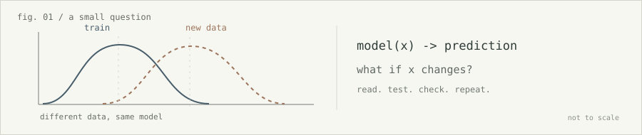

# hi, i'm sahil.

I studied Computer Science and then did my M.Tech in Data Science at IIT Jammu.

I like Python, Linux, and machine learning. I am interested in what happens when a model works on test data but does not work well on new data.

### what i'm learning

My main interest now is **reliable machine learning under distribution shift**.

I am still at the beginning of this area. These are the things I want to understand better:

- Why models fail when data changes
- How to know when a model is not sure
- How to test models properly and find failures
- How models can adapt to new data

Later I also want to study these problems in **LLMs and AI agents**. For now, I am building my basics and planning small experiments. I would rather understand a small experiment well than make a big claim about it.

### some things i worked on

- **[M.Tech thesis: encrypted network traffic classification](https://bysahil.dev/research/encrypted-traffic-classification)**. I collected traffic data for seven applications and compared different classifiers. Some results looked good, but I later found limitations in the evaluation. I wrote about them in a [revised thesis](https://bysahil.dev/thesis) and a [one-page summary](https://bysahil.dev/thesis-summary). This is one reason I became interested in reliable evaluation.
- **[pytest-asyncio pull request #1444](https://github.com/pytest-dev/pytest-asyncio/pull/1444)**. I submitted a change to the default fixture loop scope, with tests. The PR is still open.
- **[Data quality and ML evaluation pipeline](https://github.com/sahil-bhatti-ai/python-postgresql-data-quality-ml-pipeline)**. A Python and PostgreSQL project for checking data, saving clean records, and calculating evaluation metrics.
- **[Linux system test framework](https://github.com/sahil-bhatti-ai/linux-system-test-framework)**. A small Python/C++ project for running checks and writing test reports.

I also worked as a teaching assistant during my M.Tech. I helped with tutorials, labs, and checking assignments.

### tools

`Python` · `C++` · `Linux` · `PostgreSQL` · `pytest` · `FastAPI`

Currently learning more `PyTorch` and ML experiment design.

### looking ahead

I hope to apply for funded PhD positions in **2027**. I am also open to helping with small research tasks and learning from people who work on ML reliability.

I don't have everything figured out yet. I am reading, trying things, making mistakes, and learning slowly.

[website](https://bysahil.dev) · [linkedin](https://www.linkedin.com/in/sahil-bhatti-ai/) · [email](mailto:iamsahil.bhatti.official@gmail.com)
